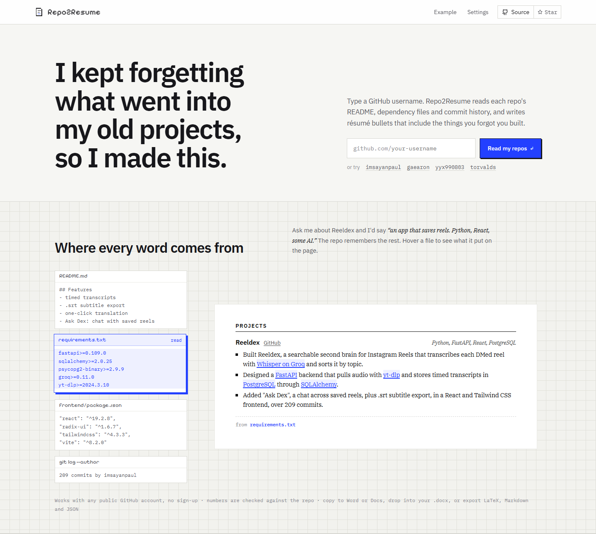
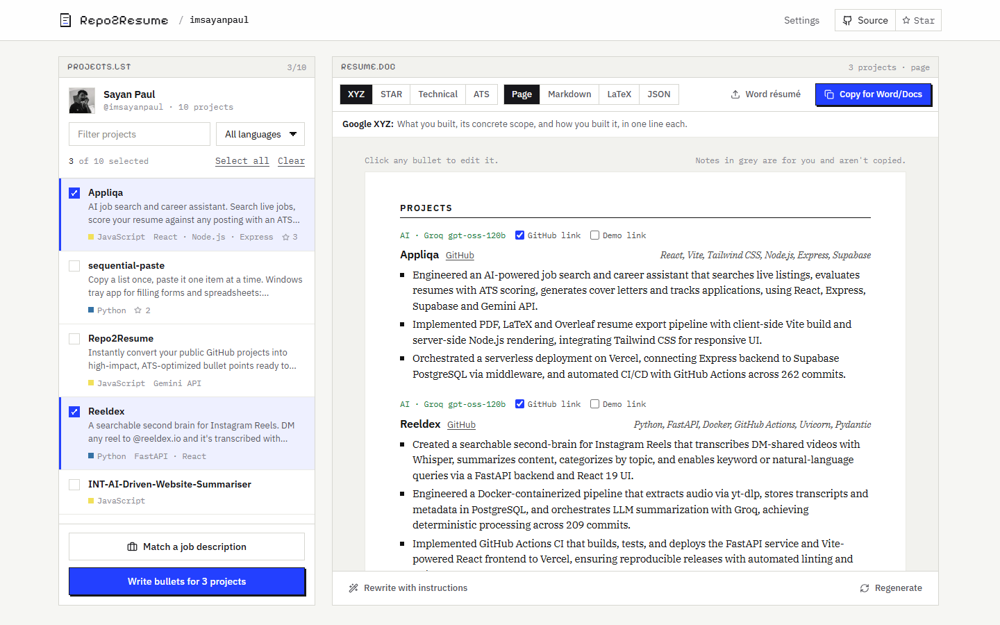

# Repo2Resume 🚀

[](LICENSE)
[](#)
[](#)

**Turn GitHub Repositories into ATS-Winning Resume Bullets.**

Instantly convert your public GitHub projects into high-impact, ATS-optimized bullet points ready to copy & paste directly into the **Projects section** of your engineering resume.

---

## 📸 Interface Previews

### 1. Executive Hero Landing Experience


### 2. Dual-Pane Workspace & Live Bullet Editor


---

## ✨ Key Features

### 🏆 1. Enforced Google XYZ Formula & STAR Presets
- **Google XYZ Formula**: Formats achievements as *"Accomplished [X] as measured by [Y], by doing [Z]"* to quantify engineering latency, throughput, and memory savings.
- **STAR Method**: Highlights *Situation/Task*, *Action taken*, and *Result achieved*.
- **Technical Depth & ATS Minimalist**: Tone presets tailored for senior engineering leaders or concise 1-page resumes.

---

### 🎯 2. Job Description Keyword Matcher
- Paste any target job description or pick sample presets (*Full-Stack Lead*, *Frontend Architect*, *Backend & Systems*).
- Automatically extracts required technical skills (`React`, `Docker`, `PostgreSQL`, `AWS`, `FastAPI`, `GraphQL`).
- Scores repository relevance (%) and injects target keywords into generated bullets to pass Applicant Tracking System (ATS) screeners.

---

### 🔍 3. Programmatic `README.md` & Dependency Parser
- Programmatically fetches and analyzes raw `README.md` architecture summaries directly via GitHub API.
- Inspects language breakdowns, topic tags, and framework dependencies (`package.json`, `Dockerfile`, `requirements.txt`, Redis, FastAPI, etc.).
- **Sparse README Immunity**: Generates accurate bullet points even if a repository has an empty or sparse README file.

---

### 📑 4. Word Resume Upload (`.docx`) & Automatic Project Injection
- **Upload Existing Resume**: Upload your existing `.docx` Word resume directly into the workspace.
- **Smart Section Detection**: Automatically locates your resume's `PROJECTS` or `PROJECT EXPERIENCE` section, handling multi-word headings (`LEADERSHIP EXPERIENCE`, `HONORS & INVOLVEMENT`), custom shading, and underline borders.
- **Auto-Formatting & Style Cloning**: Analyzes and clones your existing resume's typography (font family, size, bold lead-in action phrases, italic tech stacks, bullet indentation, and tab-stopped right-aligned links).
- **Instant 1-Click Injection**: Injects newly generated GitHub project bullets directly into your `PROJECTS` section with professional 12pt spacing, and downloads the updated `.docx` file.

---

### 📄 5. Multi-Format 1-Click Exporters
- **Rich Formatted Cards**: 1-click rich text copy for Microsoft Word and Google Docs with formatting intact.
- **LaTeX / Overleaf**: Ready-to-compile `\resumeProjectHeading` code for popular developer templates (*Jake's Resume*).
- **Markdown (`RESUME.md`)**: Clean markdown formatted for GitHub Profile READMEs or portfolio sites.
- **JSON Resume**: Standard JSON schema format.

---

### 🪄 6. Regenerate with Specific Request (Magic Wand)
- Custom AI prompt bar allowing custom instructions (*"Focus heavily on microservices and AWS deployment"*).
- Includes 1-click text suggestion chips:
  - *Emphasize 40% speedup & quantitative metrics*
  - *Highlight testing, security & code coverage*
  - *Focus on microservice backend architecture*
  - *Make concise for a 1-page resume*

---

### 🔒 7. 100% Client-Side Privacy & Offline Capability
- Stores API keys strictly in your browser's `localStorage`—never logged, tracked, or sent to middleman backend servers.
- **Smart Rule Engine**: Generates Google XYZ bullet points locally even without an internet connection or AI key.

---

## 🚀 Getting Started

### Prerequisites
- [Node.js](https://nodejs.org/) (v18.0.0 or higher)
- [npm](https://www.npmjs.com/) or [pnpm](https://pnpm.io/)

### Installation & Local Setup

```bash
# 1. Clone repository
git clone https://github.com/imsayanpaul/Repo2Resume.git

# 2. Navigate into project directory
cd Repo2Resume

# 3. Install dependencies
npm install

# 4. Launch local dev server
npm run dev
```

Open `http://localhost:3000` in your browser.

---

## 🔑 Environment Variables (Optional)

Keys stay on the server. The `/api` functions (Vercel serverless functions in production, Vite middleware in `npm run dev`) read them, and the browser only ever talks to `/api/gemini` and `/api/github`.

Create a `.env.local` file in the project root:

```env
# Gemini key for AI bullets when a visitor hasn't added their own
GEMINI_API_KEY=your_gemini_api_key_here

# Optional: GitHub token (no scopes needed) for a shared 5,000 requests/hour limit
GITHUB_TOKEN=
```

On **Vercel**, add the same two variables under *Project Settings → Environment Variables* and redeploy.

> ⚠️ **Do not use `VITE_GEMINI_API_KEY`.** Any `VITE_` variable is compiled into the JavaScript bundle, where anyone can read it, and Google revokes keys exposed that way. If an older setup has it, delete it from your environment.

*Get a free Gemini API key from [Google AI Studio](https://aistudio.google.com/app/apikey).*

Visitors can still add their own Gemini key or GitHub token in **Settings** (kept in their browser only); their own key takes priority over the server's.

**How the app stays within limits:**
- READMEs and manifest files are read from `raw.githubusercontent.com`, which doesn't count against the GitHub API limit.
- Each selected repo costs 2–3 API calls (file listing, commit count, workflows), and the results are cached in the browser until the repo changes.
- Without any GitHub token, the API allows 60 requests/hour per visitor, enough for about 15–20 repos.

**Honest output:** every number Gemini writes is checked against the README, description and real repo stats (commits, stars). Bullets with an unbacked number are regenerated once, and any number that survives is flagged in the preview with "Check before using".

---

## 📜 License

Distributed under the MIT License. See [LICENSE](LICENSE) for details.
